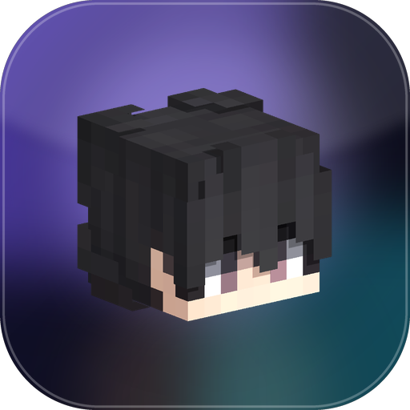

<div align="center">



# IBB Launcher

**A fast, dark-first Minecraft: Java Edition launcher for Android.**
Kotlin · Jetpack Compose · PojavLauncher-derived execution layer

</div>

---

## What it is

IBB Launcher runs desktop Minecraft: Java Edition on Android. The launcher downloads the official
game files, provisions a matching OpenJDK runtime, installs Fabric/Forge/NeoForge/Quilt profiles,
and hands the game an LWJGL/GLFW implementation that talks to Android's `EGL`/`GLES` stack.

It is not affiliated with Mojang, Microsoft or PojavLauncher.

| | |
|---|---|
| **Package** | `dev.ibb.launcher` |
| **Min SDK** | 26 (Android 8.0) — target/compile 35 |
| **ABIs** | `arm64-v8a`, `armeabi-v7a`, `x86_64` |
| **UI** | 100 % Jetpack Compose, dark-first glassmorphism, 120 Hz-safe |
| **Size** | ~18 MB APK *without* runtimes; Java runtimes download on demand (~65–95 MB each) |

## The five tabs

Home · Versions · Files · Account · Settings.

Home is a single Play card: the account, the selected version, and one button. Everything else is
reachable from those five destinations — there is no sixth place to look.

## Feature tour

### Dashboard
Quick-play card with one-tap launch, preflight status (version installed? runtime ready? account
signed in?), device telemetry (RAM, renderer, disk usage) and quick actions to versions, files and
the skin editor. Latest releases are fetched in the background — the first frame never waits on the
network.

### Versions
Full Mojang catalogue with search, release/snapshot filters and per-version install state. Loader
chips (Fabric, Quilt, Forge, NeoForge) install the loader profile on top of vanilla and merge the
`inheritsFrom` chain at launch time.

### Accounts
Microsoft sign-in through the **device-code flow** — no embedded WebView, no password ever touches
the app. Tokens are encrypted with an AES-256-GCM key held in the Android Keystore. Offline
accounts are one tap and derive a deterministic UUID, so worlds keep their inventories.

### Skins
Preset-based character customiser with a canvas-rendered voxel avatar (no image assets, no
allocation churn), classic/slim model switch and a local skin library. It lives under **Account**
rather than in its own tab, which keeps the bar to the five things a player actually needs.

### Files
Built-in explorer for the current instance: mods, resource packs, shader packs, datapacks, worlds.
Imports go through the Storage Access Framework, then the archive is sniffed
(`fabric.mod.json`, `pack.mcmeta`, `shaders/`) so a renamed file still lands in the right folder.
Nothing is ever silently overwritten; disabling renames with a `.disabled` suffix.

### Console
Not a tab: **Settings → Console** opens a full-screen sheet with the live JVM log (the game's own
stdout/stderr, level filters, pause, copy, clear, share) plus logcat. It is the only useful
diagnostic when a launch fails, so it is one tap from Settings and one tap from the in-game toolbar.
Crash reports from the previous run are surfaced on the next start with a one-tap share sheet.

### Settings
Renderer selection (**GL4ES** `opengles3`, **Zink/Vulkan** `vulkan_zink`, **OpenGL ES 2**
`opengles2`), resolution scale, vsync, big-core affinity, Adreno/Turnip preference, RAM slider
derived from *physical* RAM, JVM arguments, the Java 8/17/21 runtime manager, control-layout
editing, storage usage, the console and log export.

### In-game
Dedicated landscape `GameActivity` hosting a `SurfaceView` for the JVM-owned GL context, with a
Compose overlay for the virtual controller (joystick, look drag, mouse buttons for **attack/use**
with hold-to-repeat, macros, sneak/sprint toggles, scale/opacity), a log peek and a session sheet — all drawn in a separate window layer so
the overlay never forces the game surface into software composition.

## Build it

> Full walkthrough with troubleshooting: **[docs/BUILDING.md](docs/BUILDING.md)**

```bash
# 1. Toolchain: JDK 17 (or 21) + Android SDK 35
export JAVA_HOME=/path/to/jdk-17
export ANDROID_HOME=/path/to/android-sdk

# 2. Native side: appsrc/main/jni is compiled by ndk-build (needs the NDK, set in
#    app/build.gradle.kts). The prebuilt renderer/JVM libraries are fetched from the
#    pinned PojavLauncher commit into the (gitignored) app/src/main/jniLibs/:
./tools/fetch_native_libs.sh

# 3. Build
./gradlew :app:assembleDebug        # debug APK
./gradlew :app:testDebugUnitTest    # 81 JVM unit tests
./gradlew :app:assembleRelease      # needs keystore.properties (see docs/BUILDING.md)
```

The APK lands in `app/build/outputs/apk/debug/app-debug.apk`.

**The project cannot be compiled in this chat's sandbox** — there is no Android SDK, Gradle
distribution or Maven access here, so the code was verified with a standalone Kotlin compiler
harness instead (see *Verification* below). Building on a normal machine with the Android SDK
requires no extra steps beyond the two exports above.

## Project layout

```
app/src/main/java/
├── dev/ibb/launcher/
│   ├── core/              IbbLog, CrashHandler, IbbPaths (every on-disk location)
│   ├── data/
│   │   ├── model/         Version / Account / Settings / Control models (+ JSON schema)
│   │   ├── network/       Http (HttpURLConnection) and MojangApi
│   │   ├── auth/          MicrosoftAuth (device code → XBL → XSTS → Minecraft)
│   │   └── store/         SecureStore (Keystore), AccountStore, SettingsStore
│   ├── download/          ParallelDownloader (resume + SHA-1)
│   ├── runtime/           RuntimeManager (tar.xz JRE provisioning)
│   ├── repository/        VersionInstaller (libraries → client → assets → loader)
│   ├── mods/              ModLoaders (Fabric/Quilt/Forge/NeoForge) + ModRepository
│   ├── game/              VersionResolver, LaunchArgsBuilder, GameLauncher, GameService
│   │   └── nativebridge/  ExecutionLayer (LD_LIBRARY_PATH → preload → surface → hooks)
│   ├── controls/          ControlEngine, DefaultLayouts, ControlRepository
│   └── ui/                theme / components / screens / game overlay
├── com/oracle/dalvik/     VMLauncher — JNI ABI, do not move
├── net/kdt/pojavlaunch/   JREUtils — JNI ABI, do not move
└── org/lwjgl/glfw/        GLFW + CallbackBridge stubs the game links against
```

Architecture, data flow and the reasons behind each decision: **[docs/ARCHITECTURE.md](docs/ARCHITECTURE.md)**.
The native contract, symbol list and `.so` packaging: **[docs/NATIVE_LAYER.md](docs/NATIVE_LAYER.md)**.

## Verification

Everything in `dev.ibb.launcher.{core,data,download,runtime,repository,mods,game,controls}` compiles
against the real Kotlin 2.1.20 compiler in a standalone harness, and the pure logic is covered by
**81 unit tests** that run on the JVM:

| Suite | What it pins |
|---|---|
| `VersionResolverTest` (22) | rule DSL, library filtering, Java-version cut-offs, `${…}` expansion |
| `ControlEngineTest` (17) | hit boxes, joystick maths, mouse deltas, preset validation |
| `DataIntegrityTest` (16) | path sanitising, SHA-1, `.part` cleanup, archive sniffing |
| `LaunchArgsBuilderTest` (10) | argv shape, `-cp` handling, offline vs MSA args, log4j config |
| `HttpParsingTest` (10) | header parsing, retry policy, file naming |
| `RamHeuristicsTest` (6) | slider bounds vs. physical RAM |
| `AuthParsingTest` | MSA/XBL/XSTS payload decoding (needs the serialization plugin; runs under Gradle) |

Run them with `./gradlew :app:testDebugUnitTest`.

## Licensing & credits

- Execution layer design derived from **[PojavLauncher](https://github.com/PojavLauncherTeam/PojavLauncher)**
  and **[Amethyst-Android](https://github.com/AngelAuraMC/Amethyst-Android)** (GPLv3). If you
  redistribute an APK with those `.so` files you must publish the corresponding source.
- Java runtimes: **[angelauramc-openjdk-build](https://github.com/AngelAuraMC/angelauramc-openjdk-build)**.
- Minecraft is a trademark of Mojang Synergies AB. This project ships no Mojang code and requires
  a legitimately owned copy of the game.

See `app/src/main/assets/licenses/` for the full texts shipped inside the APK.

## Download

* **Release APK (67 MB, R8-minified)** —
  <https://github.com/itzblockboy-glitch/IBB-Launcher/releases/download/v1.3.0/app-release.apk>
* **Debug APK (85 MB, readable logs)** —
  <https://github.com/itzblockboy-glitch/IBB-Launcher/releases/download/v1.3.0/app-debug.apk>
* Checksums and notes: [v1.3.0 release](https://github.com/itzblockboy-glitch/IBB-Launcher/releases/tag/v1.3.0)

Every push is rebuilt by `.github/workflows/build-apk.yml`; pushing a `v*` tag publishes a new
release with both APKs attached.

| File | Size | Install |
|---|---|---|
| `app-release.apk` | 67 MB | `adb install -r app-release.apk` |
| `app-debug.apk` | 85 MB, no shrinking | same |

Minimum Android 8.0 (API 26). Arm64, armv7 and x86_64 are all in the one APK. The APKs are signed
with a stable key, so they upgrade over an earlier install without losing data.

### What is in the APK

Everything needed to boot Minecraft is packaged: `libpojavexec.so` (the JVM launcher and JNI
bridge), `libexithook.so`, `libgl4es_114.so`, `libOSMesa.so`, the `liblwjgl*` natives, `libopenal.so`
and `assets/components/lwjgl3/glfw-stub.jar`. The 1.0.x builds were ~4 MB precisely because none of
that was present, which is why they could not launch a game.

Still fetched on first use, because they are version- and account-specific: the Android Java
runtime matching the game (Java 8 / 17 / 21) and Mojang's libraries and assets.

### Known limits

* No Redstone-adjacent exotica: OptiFine and shader mods work, but only through their supported
  backends; Zink needs a Vulkan 1.1 driver.
* AWT-based screens (some old Forge installers) are the least-tested path — modern versions render
  through GLFW and never load AWT.
* Physical gamepads and keyboards map through the same bridge as the touch overlay, but the touch
  layouts are what is exercised by the tests.
